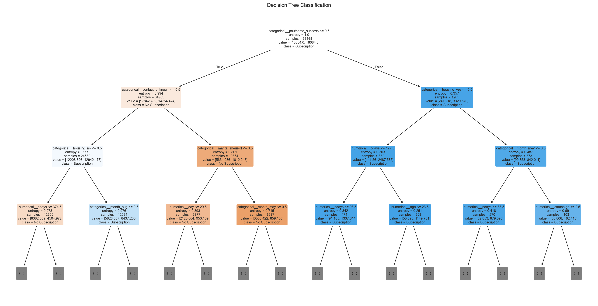
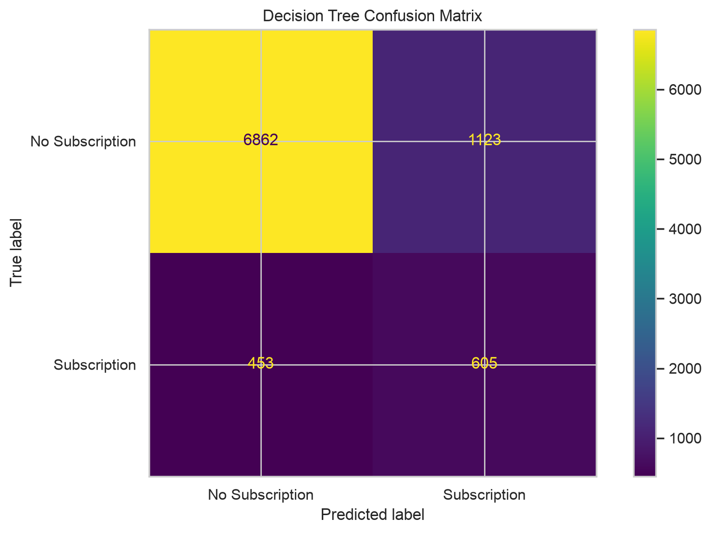
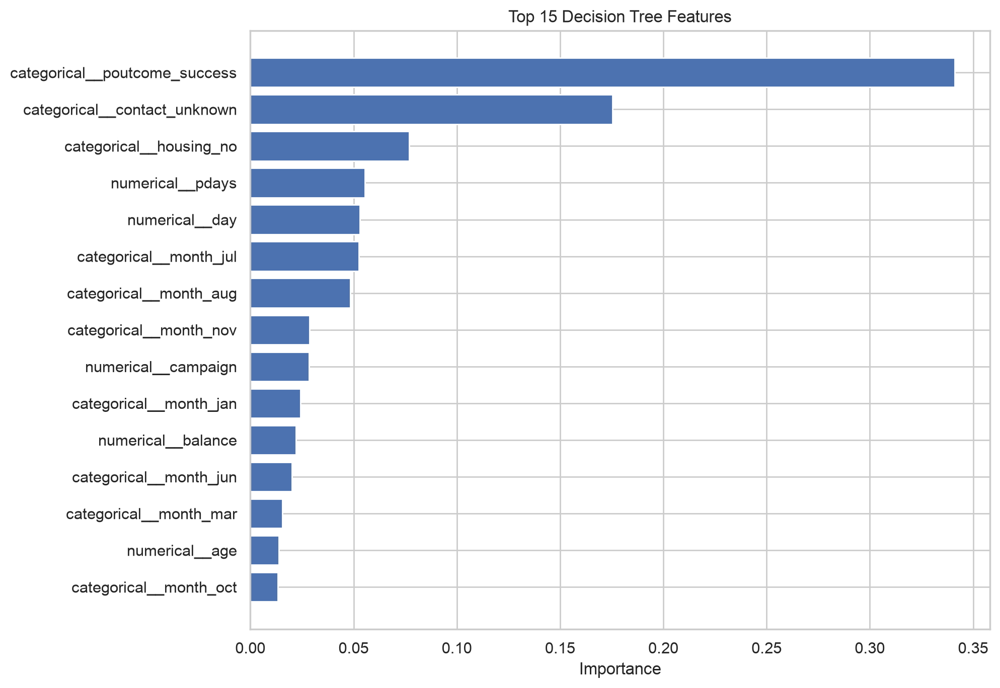

## Model Development

- Baseline Decision Tree
- Hyperparameter tuning
- Stratified cross-validation
- Comparison of Gini and entropy criteria

## Model Evaluation

Report the actual test-set results for:

- Accuracy
- Precision
- Recall
- F1-score
- ROC-AUC

## Model Interpretation

Include:

- Decision Tree visualization
- Feature importance chart
- Confusion matrix

## Error Analysis

Discuss false positives and false negatives.

## Limitations

- The target classes are imbalanced.
- Feature importance does not establish causation.
- Model performance depends on the dataset and validation strategy.
- The model has not been validated for real-world deployment.

## Model Performance

The Decision Tree classifier was optimized using
GridSearchCV with five-fold stratified cross-validation.

### Best Hyperparameters

| Parameter             | Value    |
| --------------------- | -------- |
| Criterion             | Entropy  |
| Maximum Depth         | 7        |
| Minimum Samples Split | 2        |
| Minimum Samples Leaf  | 20       |
| Class Weight          | Balanced |

### Cross-Validation Results

Best mean F1-score: 0.4336

### Test Set Results

| Metric    | No Subscription | Subscription |
| --------- | --------------- | ------------ |
| Precision | 0.94            | 0.35         |
| Recall    | 0.86            | 0.57         |
| F1-score  | 0.90            | 0.43         |

Overall Accuracy: 83%

### Key Findings

- The dataset has a substantial class imbalance.
- The Decision Tree identified approximately 57% of actual subscribers.
- Precision for the subscription class was approximately 35%.
- Accuracy alone is insufficient for evaluating this model.
- Further improvements could involve threshold tuning,
  feature engineering, and comparison with ensemble models.

### Limitations

The model is intended for educational purposes.

Its performance has not been validated on external data
or in a real-world banking environment.

## Visualizations

### Decision Tree

### Confusion Matrix

### Feature Importance

